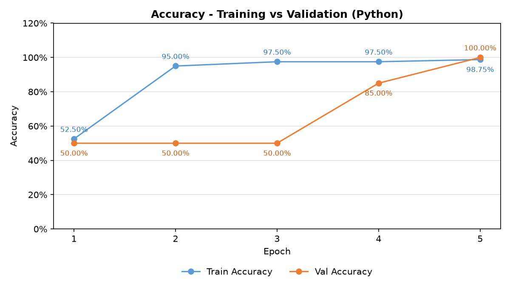
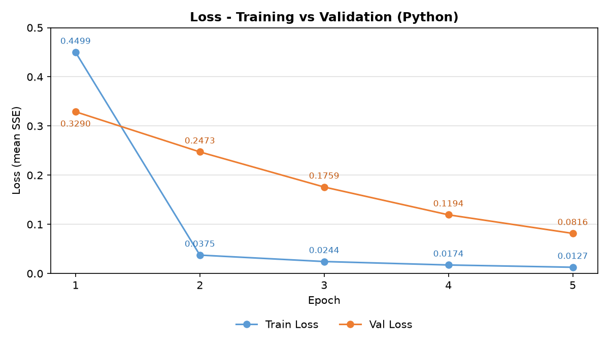

# Single Layer Perceptron – Binary Classification of Iris Data

**Assignment 1 – Single Layer Perceptron**
Dinar Nugroho Pratomo · NIM 26/591683/SPA/01279 · Program Doktor Ilmu Komputer, UGM

A from-scratch Python implementation of a Single Layer Perceptron (sigmoid neuron) that
classifies **Iris-setosa (0)** vs **Iris-versicolor (1)**. It reproduces the Google Sheets
template (`PMM-TemplateSLP`) exactly, so the accuracy and loss charts are identical.

## Setup (same as the spreadsheet)

| Item | Value |
|---|---|
| Features | X1–X4 (sepal length, sepal width, petal length, petal width) |
| Training data | 80 samples – setosa rows 1–40 + versicolor rows 51–90 |
| Validation data | 20 samples – setosa rows 41–50 + versicolor rows 91–100 |
| Initial weights | bias = θ1 = θ2 = θ3 = θ4 = 0.5 |
| Learning rate | 0.1 |
| Epochs | 5 (data order fixed, no shuffling) |
| Activation | g(z) = 1 / (1 + e^(−z)), z = bias + Σ θᵢxᵢ |
| Prediction | 1 if g(z) > 0.5 else 0 |
| Gradient | dθᵢ = 2·(g − y)·g·(1 − g)·xᵢ (x₀ = 1 for the bias) |
| Update | θᵢ ← θᵢ − lr·dθᵢ after **every** sample (online / stochastic GD) |
| Validation | uses the weights at the end of the same training epoch, no update |
| Loss | mean of SSE = (g − y)² over the epoch |
| Accuracy | correct predictions / number of samples |

## Run

```bash
pip install matplotlib
python slp.py
```

## Results

| Epoch | Train Loss | Train Acc | Val Loss | Val Acc |
|---|---|---|---|---|
| 1 | 0.449889 | 52.50% | 0.328951 | 50.00% |
| 2 | 0.037452 | 95.00% | 0.247289 | 50.00% |
| 3 | 0.024372 | 97.50% | 0.175892 | 50.00% |
| 4 | 0.017357 | 97.50% | 0.119381 | 85.00% |
| 5 | 0.012740 | 98.75% | 0.081581 | 100.00% |

These values match the spreadsheet (`SLP-Iris-Dinar.xlsx`, sheet **Hasil**) to 6 decimal places.




## Files

- `slp.py` – SLP implementation, metrics and charts
- `data/iris.csv` – the 100 setosa/versicolor rows from the template's `Data` sheet
- `outputs/` – `metrics.csv`, Python charts (`*_python.png`) and spreadsheet charts (`*_spreadsheet.png`)
- `SLP-Iris-Dinar.xlsx` – completed spreadsheet (5 epochs, training + validation + summary/charts)
- `PMM-TemplateSLP.xlsx` – original template

## References

1. Fisher, R. A. (1936). The use of multiple measurements in taxonomic problems. *Annals of Eugenics*, 7(2), 179–188.
2. Fisher, R. A. (1936). Iris [Dataset]. UCI Machine Learning Repository. https://doi.org/10.24432/C56C76
3. Rosenblatt, F. (1958). The perceptron: A probabilistic model for information storage and organization in the brain. *Psychological Review*, 65(6), 386–408.
